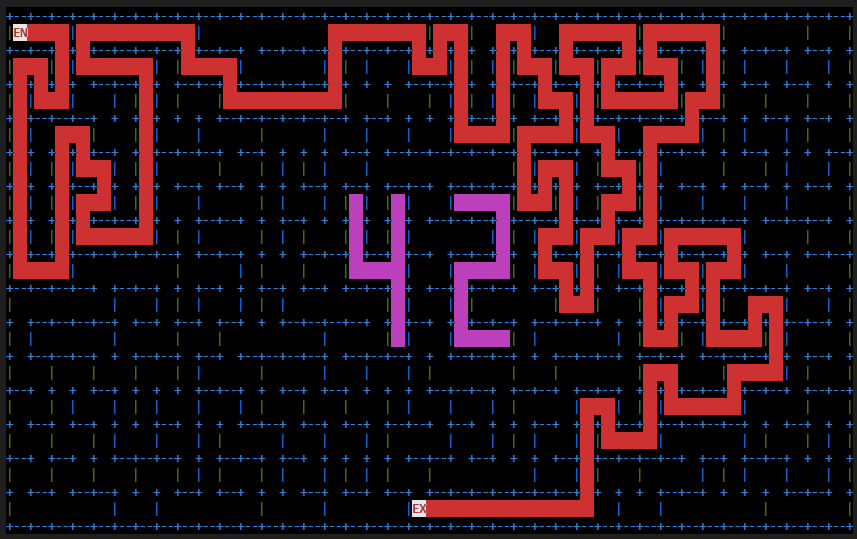
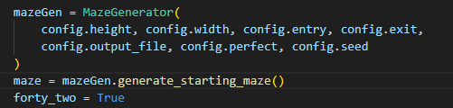
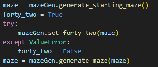

*This project has been created as part of the 42 curriculum by lmoreau and bel-azzo*

# [A-MAZE-ING]
> *“A labyrinth is not a place to be lost, but a path to be found.”*


<figure style="text-align: center;">
  
</figure>

## **Description**: 

A-Maze-ing is a Python project focused on procedural maze generation, pathfinding, and visualization.
The goal of the project is to create a configurable maze generator capable of producing coherent and playable mazes while respecting strict structural constraints.

The program reads a configuration file describing the maze parameters (dimensions, entry and exit positions, output file, generation mode, seed, etc.), generates a random maze, computes the shortest valid path between the entrance and the exit, and exports the result using a hexadecimal wall encoding format.

The project supports both perfect mazes — where only one unique path exists between two cells — and non-perfect mazes with additional openings while still preserving global connectivity.

A visual representation of the maze is also included, allowing the user to:

- display the maze in the terminal or graphically,
- regenerate mazes dynamically,
- show or hide the shortest path,
- customize wall colors,
- highlight the hidden “42” pattern embedded inside the maze.

The maze generation logic is implemented inside a reusable standalone Python module (MazeGenerator) designed to be packaged and reused in future projects. 

This project explores several important computer science concepts:

- procedural generation,
- pathfinding algorithms,
- randomness and reproducibility,
- software modularity and packaging.

The chosen generation algorithm guarantees coherent wall consistency between neighboring cells and ensures that no isolated areas exist inside the maze. A deterministic seed system also allows identical mazes to be regenerated for debugging or testing purposes.

## Instructions :

#### <u>Installation and Running</u>

```
1. Clone the repository: `git clone https://github.com/our-repo/a-maze-ing.git`

2. Move to the project root: `cd a-maze-ing`

3. Install the required package: `pip install mazegen-1.0.0-py3-none-any.whl`

4. Run the project: `make run`
   Or execute manually: `./a_maze_ing.py config.txt`
```

It is important to note that the program should ideally be run inside a clean virtual environment created beforehand.

```
1. Create the virtual environment: python3 -m venv amazing_venv
2. Activate it: source amazing_venv/bin/activate
3. Run the program (see instructions above)

(To exit the virtual environment: deactivate)
```

#### <u>Configuration file format (config.txt)</u>

```
WIDTH: Defines the number of cells horizontally in the maze.
HEIGHT: Defines the number of cells vertically in the maze.
ENTRY: Specifies the starting position of the maze, given as coordinates (x,y).
EXIT: Specifies the ending position of the maze, given as coordinates (x,y).
OUTPUT_FILE: Name of the file where the generated maze will be saved.
PERFECT: Boolean value (true/false) that determines whether the maze is perfect. A perfect maze has exactly one unique path between any two points and contains no loops.
SEED: (Optional) Integer used to initialize the random generator, allowing reproducible maze generation.
```

The configuration file defines the parameters used to generate the maze. Each entry is written as KEY: VALUE.

```
WIDTH: int (width of the maze in cells)
HEIGHT: int (height of the maze in cells)
ENTRY: x,y (starting point)
EXIT: x,y (end point)
OUTPUT_FILE: filename for output
PERFECT: true/false (perfect maze or not)
SEED: optional integer for deterministic generation
```

#### <u>Usage</u>

The parameters are used as follows:

<figure>
  <figcaption>Example of a call to the maze generator</figcaption>
  
</figure>

<figure>
  <figcaption>Main display</figcaption>
  
</figure>


#### <u>Chosen Generation Algorithm and Justification</u>

The maze generation algorithm used is DFS (Depth-First Search).

This choice was made because it is both simple to implement and efficient for maze generation.

DFS allows the maze to be generated while being explored at the same time, making it particularly suitable for this project. It also produces more natural and visually appealing maze structures, with long and winding paths instead of overly uniform patterns.

Therefore, this algorithm provides a good balance between simplicity, performance, and visual quality.


#### <u>Reusable Code</u>

A major part of the project is designed to be reusable:

- **MazeGenerator module**
  → can be imported independently to generate mazes in other projects

- **MazeRenderer**
  → separated visual layer that can be reused for other grid-based displays

- **BFS solver**
  → independent pathfinding module usable for any grid graph

These components are decoupled from the main program logic and can be reused by importing the module or packaging it.


#### <u>Team Management:</u>

- bel-azzo: algorithm part (maze generation, solver, seed handling)

- lmoreau: visual part  (renderer, curses display, UI)


<u>Tools used:</u>
- Git (version control)
- GitHub (collaboration)
- Discord (communication)
- basic task splitting per day

<u>Strengths:</u>

The task distribution was effective, based on each member’s skills. This organization allowed good complementarity and constant mutual support.
Collaboration was smooth, with good time management: daily goals were realistic and consistently achieved on time.

<u>Areas for improvement:</u>

The project was completed within the allocated time without overloading our daily workload, while working collaboratively.
Whenever we encountered a problem, we communicated quickly to solve it together.
From our perspective, there are no major areas for improvement in this project.

**--------------------------------------------------------------------------------------------------------------------------**

<details open>
  <summary><b>Project planning</b></summary>
  <br>
	<table style="width: 100%;">
	<tr>
		<td style="width: 50%; vertical-align: top;">
		<h3>Bel-azzo</h3>
		<ul>
			<li>Day 1 : Structure Cell + parsing</li>
			<li>Day 2 : Interface MazeGenerator</li>
			<li>Day 3 : Algorithme DFS + gestion seed</li>
			<li>Day 4 : Gestion erreur 3*3 </li>
			<li>Day 5 : Pattern "42"</li>
			<li>Day 6 : BFS solver</li>
			<li>Day 7 : Fichier sortie hex + Package pip/build.whl</li>
		</ul>
		</td>
		<td style="width: 40%; vertical-align: top;">
		<h3>Lmoreau</h3>
		<li>Day 1 : Wireframe ASCII</li>
		<li>Day 2 : Class MazeRenderer</li>
		<li>Day 3 : curses init + dessin murs</li>
		<li>Day 4 : Affichage Entry/Exit</li>
		<li>Day 5 : Pattern "42"</li>
		<li>Day 6 : Overlay chemin + "42"</li>
		<li>Day 7 : Read.me</li>
		</td>
	</tr>
	</table>
</details>

**--------------------------------------------------------------------------------------------------------------------------**


## Resources : 

#### AI Usage :

- debugging assistance (error analysis in maze generation)
- Improvement of the README
- 3x3 logic
- Learning how to create a package
- Focused documentation research
- Learning how to write docstrings
- Learning the capabilities of the curses library

<details open>
  <br>
	<table style="width: 100%;">
	<tr>
		<td style="width: 50%; vertical-align: top;">
		<h4>Algo part</h4>
		<ul>
			<li>https://medium.com/@nacerkroudir/randomized-depth-first-search-algorithm-for-maze-generation-fb2d83702742</li>
			<li>https://dqwertyc.github.io/unity-maze-generator/</li>
			<li>https://www.w3schools.com/python/</li>
			<li>Jhttps://docs.python.org/3.12</li>
		</ul>
		</td>
		<td style="width: 50%; vertical-align: top;">
		<h4>Visual part</h4>
		<li>https://docs.python.org/3/howto/curses.html</li>
		<li>https://realpython.com/ref/stdlib/curses/</li>
		<li>https://talks.freelancerepublik.com/regles-ecrire-readme-md-github/</li>
		</td>
	</tr>
	</table>
</details>


> This is the way 
