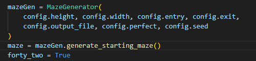
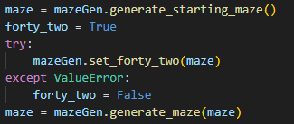

*This package was created as part of the 42 curriculum by bel-azzo and lmoreau.*
This package provides a maze generator.

Command to install it: 

`pip install mazegen-1.0.0-py3-none-any.whl`


## <u>Config.txt</u>

```
WIDTH: Defines the number of cells horizontally in the maze.
HEIGHT: Defines the number of cells vertically in the maze.
ENTRY: Specifies the starting position of the maze, given as coordinates (x,y).
EXIT: Specifies the ending position of the maze, given as coordinates (x,y).
OUTPUT_FILE: Name of the file where the generated maze will be saved.
PERFECT: Boolean value (true/false) that determines whether the maze is perfect. A perfect maze has exactly one unique path between any two points and contains no loops.
SEED: (Optional) Integer used to initialize the random generator, allowing reproducible maze generation.
```

The configuration file defines the parameters used to generate the maze. Each entry is written as KEY: VALUE.

```
WIDTH: int (width of the maze in cells)
HEIGHT: int (height of the maze in cells)
ENTRY: x,y (starting point)
EXIT: x,y (end point)
OUTPUT_FILE: filename for output
PERFECT: true/false (perfect maze or not)
SEED: optional integer for deterministic generation
```

## <u>Usage</u>

The parameters are used as follows:

<figure>
  <figcaption>Example of a call to the maze generator</figcaption>
  
</figure>

<figure>
  <figcaption>Main display</figcaption>
  
</figure>
